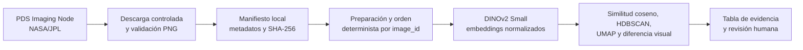

# MARS-EVIDENCE

Piloto de trazabilidad y observabilidad de representaciones visuales sobre imágenes públicas Mastcam-Z del rover Perseverance. El proyecto construye evidencia inspeccionable para comparar imágenes y facilitar su revisión humana.

No es un clasificador entrenado para Marte, un detector de descubrimientos científicos ni un sistema desplegado. Una puntuación visual no identifica vida, fósiles, minerales ni objetos desconocidos.

## Problema y objetivo

Un vector o una puntuación del modelo, por sí solos, no permiten explicar qué imagen los produjo, con qué otras imágenes se comparó o qué condiciones de procesamiento intervinieron. Este piloto vincula resultados técnicos con la procedencia de cada imagen, sus metadatos y una ruta de revisión humana.

La **trazabilidad implementada** conserva identificadores, URL de origen, hashes SHA-256, metadatos del piloto, el orden de los embeddings y las relaciones de similitud. La **observabilidad de ejecuciones** todavía está pendiente: el proyecto no registra aún, por ejecución, la revisión exacta del modelo, el preprocesamiento efectivo, la duración, una línea base ni cambios de distribución.

## Estado actual

### Implementado

- Descarga limitada y validada de productos browse Mastcam-Z desde el PDS Imaging Node de NASA/JPL.
- Construcción de un manifiesto local con identificadores, URL de imagen y metadatos, dimensiones, formato y SHA-256.
- Extracción de embeddings con `facebook/dinov2-small` y validación de su alineación con `image_id`.
- Búsqueda de vecinos por similitud coseno, agrupación exploratoria con HDBSCAN, proyección UMAP para inspección y puntuación de diferencia visual basada en vecinos cercanos.
- Exportación de una tabla de evidencia con campos de revisión humana.

### Resultados comprobados localmente

Los artefactos locales disponibles corresponden a un piloto de 40 imágenes: una por sol entre los soles 4 y 89, con 20 de `Mast Camera Zoom Left` y 20 de `Mast Camera Zoom Right`. El artefacto de embeddings tiene forma `(40, 384)` y tipo `float32`. La tabla de evidencia contiene 40 filas; todas empiezan con `human_review_status=pending` y `reviewed=False`.

Estos resultados describen un lote técnico pequeño. No representan toda la diversidad de imágenes de Marte ni validan desempeño predictivo, degradación del modelo o una conclusión científica.

### Próximos pasos

La prioridad es registrar cada ejecución y vincularla con los artefactos y la revisión humana: revisión exacta del modelo, preprocesamiento, configuración, dispositivo, duración, hashes de entrada y resultados. Comparar imágenes nuevas con una línea base del piloto y monitorizar cambios es trabajo futuro, no una capacidad actual.

## Flujo del proyecto



UMAP se usa únicamente para visualizar relaciones entre embeddings. La similitud y la puntuación se calculan en el espacio original de embeddings.

## Tecnologías

| Herramienta | Responsabilidad en este proyecto |
| --- | --- |
| Python | Ejecución del pipeline y utilidades. |
| Pillow | Verificación y lectura de archivos de imagen. |
| PyTorch y Transformers | Carga local de DINOv2 y extracción de embeddings. |
| NumPy y pandas | Artefactos numéricos, manifiestos y tablas de evidencia. |
| scikit-learn | Similitud coseno y vecinos cercanos. |
| UMAP y HDBSCAN | Proyección visual y agrupación exploratoria. |
| JupyterLab, Matplotlib y Seaborn | Exploración y generación local de figuras. |
| pytest y Ruff | Pruebas y análisis estático. |

FAISS CPU es una dependencia opcional; la implementación de similitud utilizada por el flujo se apoya en scikit-learn.

## Instalación

El proyecto declara soporte para Python `>=3.11,<3.12`.

Desde la raíz del repositorio, en macOS o Linux:

```bash
python3.11 -m venv .venv
source .venv/bin/activate
python -m pip install --upgrade pip
python -m pip install -e ".[dev]"
```

En Windows PowerShell:

```powershell
py -3.11 -m venv .venv
.venv\Scripts\Activate.ps1
python -m pip install --upgrade pip
python -m pip install -e ".[dev]"
```

El código selecciona CUDA cuando PyTorch lo informa disponible; si no, usa Apple Silicon MPS cuando está disponible y, en caso contrario, CPU. Esta selección es automática; el proyecto no declara ni prueba una matriz de compatibilidad adicional para aceleradores.

Opcionalmente:

```bash
python -m pip install -e ".[dev,faiss]"
```

Compruebe el entorno instalado:

```bash
python scripts/validate_environment.py
```

## Ejecución reproducible

Ejecute los comandos desde la raíz del repositorio y con el entorno virtual activado.

1. Revise las URL y el límite del piloto sin descargar archivos:

   ```bash
   python scripts/download_mastcam_z_pilot.py --dry-run \
     --selection-file data/metadata/mastcam_z_pilot_selection.csv \
     --limit 40
   ```

2. Descargue el piloto. El descargador admite solo HTTPS en `pds-imaging.jpl.nasa.gov`, limita el lote a 50, valida las imágenes con Pillow, calcula hashes y no sobrescribe un archivo local válido.

   ```bash
   python scripts/download_mastcam_z_pilot.py \
     --selection-file data/metadata/mastcam_z_pilot_selection.csv \
     --limit 40
   ```

3. Construya o actualice el manifiesto local, conservando los metadatos de la selección:

   ```bash
   python scripts/build_manifest.py
   ```

4. Abra el notebook de revisión y ejecute sus celdas en orden:

   ```bash
   jupyter lab notebooks/02_pilot_evidence_review.ipynb
   ```

   El notebook reutiliza `outputs/embeddings/dinov2_small_pilot.npy` y su archivo de orden si existen. Si no existen, su celda de embeddings instancia DINOv2 y descarga los pesos mediante Transformers; para ello necesita conexión a internet y puede tardar más en CPU. Luego crea las tablas y figuras en `outputs/`.

`notebooks/01_mars_evidence_exploration.ipynb` tiene `RUN_DINOV2 = True`: si hay imágenes locales y se ejecuta esa celda, carga DINOv2. Por tanto, DINOv2 **no está desactivado por defecto en ese notebook**. La clase del modelo carga pesos de forma diferida, únicamente cuando se instancia.

## Datos y procedencia

La selección incluida en [`data/metadata/mastcam_z_pilot_selection.csv`](data/metadata/mastcam_z_pilot_selection.csv) identifica los 40 productos del piloto. Tras la descarga, [`data/metadata/mastcam_z_pilot.csv`](data/metadata/mastcam_z_pilot.csv) incorpora, entre otros campos:

- `image_id`, `file_name` y `relative_path` para vincular la imagen local.
- `source_url` y `metadata_url` para volver al producto y su etiqueta de procedencia.
- `sol`, fecha terrestre, cámara y ojo.
- dimensiones, formato, tamaño y `sha256`.

SHA-256 es una huella criptográfica del archivo: permite detectar cambios o duplicados y relacionar un resultado con la imagen exacta que se procesó.

Las imágenes se descargan localmente en `data/raw/mastcam_z/pilot/` y no se versionan. La fuente es el [Mars 2020 Mastcam-Z Operations Calibrated Product Bundle del PDS](https://pds.nasa.gov/ds-view/pds/viewBundle.jsp?identifier=urn%3Anasa%3Apds%3Amars2020_mastcamz_ops_calibrated&version=13.0); las URL individuales del piloto apuntan al [PDS Imaging Node](https://pds-imaging.jpl.nasa.gov/). El campo `credit` del manifiesto indica `NASA/JPL-Caltech/ASU`.

Los datos de imagen, los pesos del modelo y el código tienen procedencias distintas. Este repositorio no concede una licencia sobre los productos PDS ni redistribuye los pesos de DINOv2; consulte la fuente de datos y la tarjeta del modelo para sus condiciones y citas aplicables.

## Resultados y artefactos

Las salidas se generan localmente y están excluidas de Git:

| Ruta | Contenido |
| --- | --- |
| `outputs/embeddings/dinov2_small_pilot.npy` | Matriz de embeddings `float32`. |
| `outputs/embeddings/dinov2_small_pilot_image_ids.npy` | Orden exacto de `image_id` correspondiente a la matriz. |
| `outputs/reports/pilot_evidence_table.csv` | Tabla trazable para revisión humana. |
| `outputs/reports/top_anomalies.csv` | Diez filas con mayor puntuación de diferencia visual. |
| `outputs/figures/pilot_umap_clusters.png` | Proyección UMAP coloreada por etiqueta HDBSCAN. |
| `outputs/figures/top_anomalies_grid.png` | Galería local de las diez imágenes con mayor puntuación. |
| `outputs/figures/anomaly_neighbors_grid.png` | Consultas y vecinos visuales de las primeras anomalías del ranking. |

En la tabla de evidencia:

- `image_id` identifica la entrada de forma estable.
- `nearest_image_1` a `nearest_image_3` y sus similitudes muestran los tres vecinos más cercanos por similitud coseno, excluyendo la propia imagen.
- `cluster_id` es la etiqueta exploratoria de HDBSCAN; `-1` significa ruido para ese algoritmo.
- `anomaly_score` es la distancia coseno media a cinco vecinos cercanos, normalizada dentro del lote; `anomaly_rank` ordena esa puntuación de mayor a menor.
- `human_review_status`, explicación, artefactos posibles y notas reservan la revisión humana.

Un score alto expresa diferencia visual relativa a este conjunto y a estos parámetros. No es una probabilidad, una tasa de error, una alerta de degradación ni una conclusión científica.

## Validación humana y limitaciones

La tabla se inicializa con `human_review_status=pending`, `reviewed=False` y campos de explicación vacíos. El notebook presenta una plantilla editable de revisión; el proceso previsto es que una persona inspeccione la imagen, sus vecinos y metadatos, documente la decisión y vuelva a exportar la tabla. El repositorio no contiene aún decisiones humanas registradas.

Limitaciones principales:

- El piloto tiene 40 imágenes y no cubre la diversidad de condiciones, instrumentos ni productos de Perseverance.
- DINOv2 Small es un modelo visual preentrenado para extraer características; no fue ajustado ni evaluado aquí como clasificador marciano.
- La iluminación, compresión, desenfoque, partes del rover, cobertura del lote y parámetros de UMAP/HDBSCAN/vecinos pueden afectar los resultados.
- UMAP puede distorsionar distancias al proyectar a dos dimensiones; no debe usarse como medida científica de similitud.
- Comparar imágenes o registrar tiempos no demuestra degradación del modelo ni calidad predictiva.

## Tests y calidad

Ejecute:

```bash
python -m pytest
python -m ruff check .
```

En la revisión local de este README, ambos comandos finalizaron correctamente: `14 passed` y `All checks passed!`.

## Estructura del repositorio

```text
config/base.yaml                         Configuración del piloto y análisis.
data/metadata/                           Selección y manifiesto versionados.
data/raw/                                Imágenes locales descargadas, excluidas de Git.
notebooks/01_mars_evidence_exploration.ipynb  Exploración inicial.
notebooks/02_pilot_evidence_review.ipynb      Evidencia, figuras y revisión humana.
outputs/                                 Embeddings, informes y figuras locales, excluidos de Git.
scripts/download_mastcam_z_pilot.py      Descarga controlada del piloto.
scripts/build_manifest.py                Construcción del manifiesto.
scripts/validate_environment.py          Diagnóstico del entorno.
src/mars_evidence/                       Código de datos, embeddings y análisis.
tests/                                   Pruebas automatizadas.
```

## Referencias y licencia

- [PDS: Mastcam-Z Operations Calibrated Product Bundle](https://pds.nasa.gov/ds-view/pds/viewBundle.jsp?identifier=urn%3Anasa%3Apds%3Amars2020_mastcamz_ops_calibrated&version=13.0)
- [PDS: contexto del instrumento Mastcam-Z](https://pds.nasa.gov/ds-view/pds/viewContext.jsp?identifier=urn%3Anasa%3Apds%3Acontext%3Ainstrument%3Amars2020.mastcamz&version=1.3)
- [DINOv2: Learning Robust Visual Features without Supervision](https://arxiv.org/abs/2304.07193)
- [Tarjeta del modelo `facebook/dinov2-small`](https://huggingface.co/facebook/dinov2-small)

El código y la documentación de este repositorio se distribuyen bajo la [licencia MIT](LICENSE). Esta licencia no sustituye las condiciones de los datos PDS ni de los pesos del modelo.
